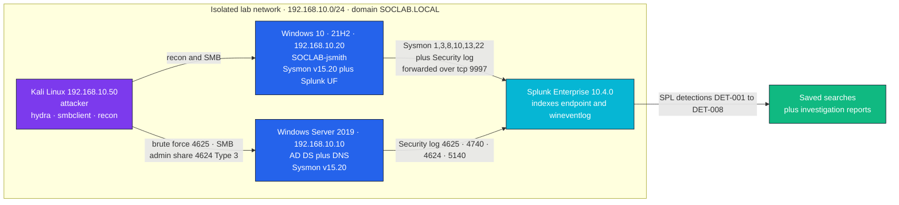
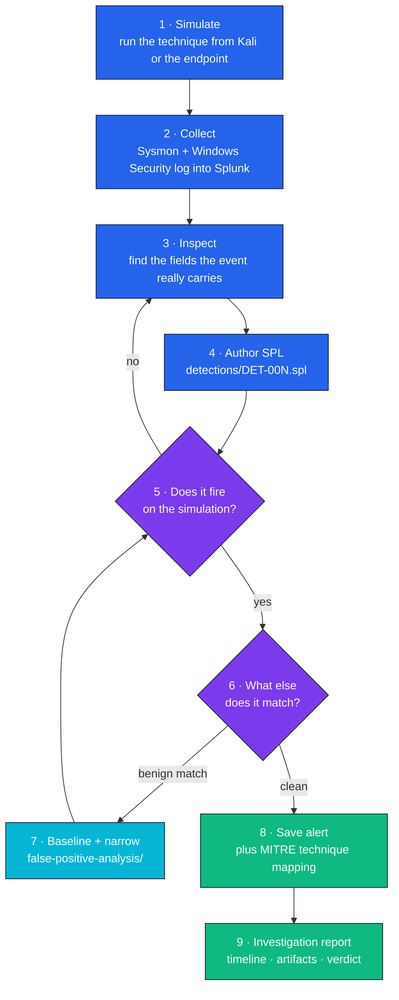

<div align="center">

# 🛡️ SOC Analyst Portfolio

### Enterprise Active Directory detection lab — simulate, detect, investigate, tune

**A 3-VM `SOCLAB.LOCAL` domain with a dedicated Kali attacker, instrumented with Sysmon and Splunk.
Eight SPL detections were authored against the telemetry those attacks actually produced, each one
screenshotted firing, mapped to MITRE ATT&CK, and written up as an analyst investigation.
This is a controlled lab, not a production SOC deployment.**

[](configs/splunk/)
[](configs/sysmon/sysmonconfig.xml)
[](lab-setup/vm-build-notes.md)
[](attack-simulations/)
[](mitre-attack-mapping/mitre-mapping-table.md)

[](detections/)
[](labs/)
[](investigation-reports/)
[](#-known-limitations)

[Overview](#-overview) · [Lab architecture](#-lab-architecture) · [Workflow](#-detection-engineering-workflow) · [Detections](#-detection-matrix--enterprise-ad-lab) · [Labs](#-lab-matrix--standalone-labs) · [Tuning](#-detection-tuning-det-001) · [ATT&CK](#-mitre-attck-coverage) · [Evidence](#-evidence--reports) · [Limitations](#-known-limitations)

</div>

---

## 📌 Overview

Most "SOC portfolios" show screenshots of someone else's dashboard. This one is built the other way
round: **the attack comes first, the telemetry is whatever the attack really generated, and the
detection is written afterwards against those events** — then tuned when it fires on something
benign.

| | |
|---|---|
| **What it is** | A 3-VM Active Directory lab (domain controller, Windows 10 endpoint, Kali attacker) with Sysmon on both Windows hosts and Splunk Enterprise indexing the telemetry. |
| **What it produces** | 8 committed SPL detection files, 8 attack-simulation write-ups, 6 standalone single-host labs, 6 investigation reports plus one executive incident report, and a documented false-positive/tuning analysis. |
| **Who it is for** | Anyone assessing whether I can write a detection, prove it fires, explain why it fires on benign activity, and narrow it without breaking it. |
| **Why the architecture** | A separate Kali host is the point. Attacks launched from another machine produce *network* logon events (Type 3) and real source IPs — local simulations do not, and detections tuned only on local activity miss the lateral-movement case entirely. |

---

## 🎯 Problem Statement

A detection that has never fired is a hypothesis, and a detection that has only fired on the
attack it was written for is an overfit hypothesis. The engineering problem this lab exists to
practise is the gap between those two states:

1. **Generate the telemetry honestly.** `-EncodedCommand` PowerShell, `hydra`/`smbclient` against
   the domain, `rundll32 comsvcs.dll` against LSASS, `schtasks`, Run-key writes, `mavinject`,
   ADMIN$ access from Kali, periodic DNS queries.
2. **Write SPL against the fields those events actually contain** — not against field names from a
   blog post that do not exist in this Sysmon configuration.
3. **Find out what else it matches.** DET-001's first version matched the Splunk Universal
   Forwarder's own PowerShell activity. That is the real work.
4. **Record what remains uncertain.** T1055 in Lab 2 is marked *suspected*, not confirmed, because
   Sysmon Event 8/10 evidence was not captured for it.

---

## 🧱 Lab Architecture



**Trust boundary.** The lab network is isolated and has no route to any production or third-party
network. The Kali host is the only untrusted node; the domain controller is both the AD authority
and the Splunk indexer, which is acceptable in a lab and would be a design fault in production
(see [Known Limitations](#-known-limitations)).

Build notes: [`lab-setup/`](lab-setup/) · [`configs/`](configs/) ·
proof of the domain and forwarding path: [`screenshots/lab-architecture/`](screenshots/lab-architecture/)

---

## 🔄 Detection Engineering Workflow



Step 6 and step 7 are the steps that distinguish detection engineering from writing a search.

---

## 🔍 Detection Matrix — Enterprise AD Lab

Eight detections, each with a committed `.spl` file, a simulation write-up, a screenshot of the
detection firing, and an investigation report.

| ID | Detection | Technique | Tactic | Launched from | Telemetry | Evidence |
|---|---|---|---|---|---|---|
| **DET-001** | [Suspicious PowerShell execution](detections/powershell-suspicious-execution.spl) | T1059.001 | Execution | Win10 endpoint | Sysmon 1 | [sim](attack-simulations/01-powershell-suspicious-execution.md) · [screenshot](screenshots/splunk-searches/det-001-powershell-fired.png) · [report](investigation-reports/powershell-investigation-report.md) |
| **DET-002** | [Brute-force login](detections/brute-force-login.spl) | T1110.001 | Credential Access | **Kali** | Security 4625 / 4740 | [sim](attack-simulations/02-brute-force-login.md) · [screenshot](screenshots/splunk-searches/det-002-brute-force.png) · [report](investigation-reports/brute-force-investigation-report.md) |
| **DET-003** | [LSASS access (credential dumping)](detections/credential-dumping-simulation.spl) | T1003.001 | Credential Access | Win10 endpoint | Sysmon 10 | [sim](attack-simulations/03-credential-dumping-simulation.md) · [screenshot](screenshots/splunk-searches/det-003-lsass-access.png) · [report](investigation-reports/credential-dumping-investigation-report.md) |
| **DET-004** | [Scheduled-task persistence](detections/scheduled-task-persistence.spl) | T1053.005 | Persistence | Win10 endpoint | Security 4698 · Sysmon 1 | [sim](attack-simulations/04-scheduled-task-persistence.md) · [screenshot](screenshots/splunk-searches/det-004-scheduled-task.png) · [report](investigation-reports/persistence-investigation-report.md) |
| **DET-005** | [Registry Run-key persistence](detections/registry-run-key-persistence.spl) | T1547.001 | Persistence | Win10 endpoint | Sysmon 13 | [sim](attack-simulations/05-registry-run-key-persistence.md) · [screenshot](screenshots/splunk-searches/det-005-registry-run-key.png) · [report](investigation-reports/persistence-investigation-report.md) |
| **DET-006** | [Process-injection indicators](detections/process-injection-indicators.spl) | T1055 | Defense Evasion | Win10 endpoint | Sysmon 8 / 10 | [sim](attack-simulations/06-process-injection-indicators.md) · [screenshot](screenshots/splunk-searches/det-006-process-injection.png) · [report](investigation-reports/persistence-investigation-report.md) |
| **DET-007** | [Lateral movement via SMB admin shares](detections/lateral-movement-attempts.spl) | T1021.002 | Lateral Movement | **Kali** | Security 4624 Type 3 · 5140 | [sim](attack-simulations/07-lateral-movement-attempts.md) · [screenshot](screenshots/splunk-searches/det-007-lateral-movement.png) · [report](investigation-reports/lateral-movement-investigation-report.md) |
| **DET-008** | [DNS/HTTP beacon-like traffic](detections/dns-http-beacon-like-traffic.spl) | T1071.001 / T1071.004 | Command & Control | Win10 endpoint | Sysmon 22 / 3 | [sim](attack-simulations/08-dns-http-beacon-like-traffic.md) · [screenshot](screenshots/splunk-searches/det-008-dns-beacon-all-vms.png) · [report](investigation-reports/beaconing-investigation-report.md) |

Full detection cards — logic, key fields, alert thresholds, documented false positives and triage
steps: [`detections/detection-index.md`](detections/detection-index.md).

<details>
<summary>DET-001 — Suspicious PowerShell Execution (committed SPL)</summary>

```spl
index=endpoint sourcetype="XmlWinEventLog:Microsoft-Windows-Sysmon/Operational"
"<EventID>1</EventID>"
| rex field=_raw "<Data Name='Image'>(?<Image>[^<]+)</Data>"
| rex field=_raw "<Data Name='CommandLine'>(?<CommandLine>[^<]+)</Data>"
| rex field=_raw "<Data Name='ParentImage'>(?<ParentImage>[^<]+)</Data>"
| rex field=_raw "<Data Name='User'>(?<User>[^<]+)</Data>"
| search Image="*powershell*"
    (CommandLine="*EncodedCommand*" OR CommandLine="*ExecutionPolicy Bypass*"
     OR CommandLine="*WindowStyle Hidden*" OR CommandLine="*DownloadString*")
| table _time, host, User, Image, ParentImage, CommandLine
| sort -_time
```

**Observed result:** fired on `SOCLAB\jsmith` running encoded PowerShell spawned from `cmd.exe` —
confirmed true positive. Full file: [`detections/powershell-suspicious-execution.spl`](detections/powershell-suspicious-execution.spl)

</details>

<details>
<summary>DET-002 — Brute-force login (committed SPL, threshold ≥ 10 in 5 min)</summary>

```spl
index=wineventlog sourcetype="WinEventLog:Security"
EventID=4625
| bucket _time span=5m
| stats count AS failure_count,
        values(IpAddress) AS source_ips,
        dc(IpAddress) AS unique_source_count,
        values(Logon_Type) AS logon_types
  BY _time, Account_Name, ComputerName
| where failure_count >= 10
| eval severity=case(failure_count >= 50, "Critical", failure_count >= 20, "High", 1=1, "Medium")
| eval network_logon=if(mvfind(logon_types,"3") >= 0, "YES — possible remote brute force", "NO — local/interactive")
| table _time, ComputerName, Account_Name, failure_count, source_ips, network_logon, severity
| sort -failure_count
```

**Observed result:** 11 failed SMB logons from Kali (`192.168.10.50`) against `testuser01`,
followed by account lockout (Event 4740) — the lockout correlation query confirms impact.
The file also ships a lockout-only query and a combined failures-then-lockout query.

</details>

---

## 🧪 Lab Matrix — Standalone Labs

Six single-host labs covering attack phases the enterprise lab does not, each with real Windows
telemetry and a documented finding.

| # | Lab | Techniques | Telemetry | Finding | Evidence |
|---|---|---|---|---|---|
| 1 | [Recon detection](labs/Lab1-Recon-Detection.md) | T1033, T1016, T1082 | Sysmon 1 | Recon commands observed under both SYSTEM and user context — possible dual foothold, or one actor in two security contexts | [timeline](screenshots/splunk-searches/lab1-recon-timeline.png) · [detail](screenshots/splunk-searches/lab1-whoami-detail.png) |
| 2 | [PowerShell detection](labs/Lab2-PowerShell-Detection.md) | T1059.001, T1027 | Sysmon 1 | `RuntimeBroker.exe → PowerShell` — anomalous parent/child; **T1055 suspected, not confirmed** | [screenshot](screenshots/splunk-searches/lab2-powershell-detected.png) |
| 3 | [Brute-force detection](labs/Lab3-Brute-Force-Detection.md) | T1110.001 | Security 4625 | 10 failed logons in 5 seconds from localhost via `svchost` | [timeline](screenshots/splunk-searches/lab3-brute-force-timeline.png) · [detail](screenshots/splunk-searches/lab3-brute-force-detail.png) |
| 4 | [Phishing triage](labs/Lab4-Phishing-Triage.md) | T1566.001, T1027, T1036.007 | email artifacts | Base64 URL decoded to `evil.com/steal`; `pdf.exe` double-extension attachment identified | [runbook RB-001](rubnooks/RB-001-Phishing-Triage.md) |
| 5 | [RDP auth & explicit credential use](labs/Lab5-RDP-Lateral-Movement.md) | T1021.001, T1078 *(partial)* | Security 4648 | `cmdkey` credential enumeration then local RDP session — **local scope only, adversary abuse not confirmed** | [screenshot](screenshots/splunk-searches/lab5-rdp-lateral-movement.png) |
| 6 | [Persistence hunt](labs/Lab6-Persistence-Hunt.md) | T1547.001, T1543.003, T1547.004 | Sysmon 1, 13 | Three simultaneous persistence mechanisms: Run key + fake service + Winlogon hijack | [screenshot](screenshots/splunk-searches/lab6-persistence-hunt.png) |

### Attack chain covered across both parts

```mermaid
flowchart LR
    IA["Initial Access<br/>Lab 4<br/>T1566.001"] --> EX["Execution<br/>Lab 2 · DET-001<br/>T1059.001"]
    EX --> DI["Discovery<br/>Lab 1<br/>T1033 T1016 T1082"]
    DI --> CA["Credential Access<br/>Lab 3 · DET-002 · DET-003<br/>T1110.001 T1003.001"]
    CA --> LM["Lateral Movement<br/>Lab 5 · DET-007<br/>T1021.001 T1021.002"]
    LM --> PE["Persistence<br/>Lab 6 · DET-004 · DET-005<br/>T1547.001 T1543.003 T1053.005"]
    PE --> DE["Defense Evasion<br/>DET-006<br/>T1055 T1027 T1036.007"]
    DE --> C2["Command and Control<br/>DET-008<br/>T1071.001 T1071.004"]

    classDef ph fill:#2563EB,stroke:#0F172A,color:#fff
    class IA,EX,DI,CA,LM,PE,DE,C2 ph
```



---

## 🔧 Detection Tuning (DET-001)

The tuning record is the part of this repository I would most want read.

| Stage | What happened |
|---|---|
| **v1 authored** | `Image="*powershell*"` plus suspicious-flag matching on Sysmon Event 1. Fired on the simulation. |
| **False positive found** | It also matched PowerShell activity belonging to the **Splunk Universal Forwarder itself** — the monitoring agent, firing the monitoring rule. |
| **Baselined** | Reviewed the forwarder's normal PowerShell invocations in `index=endpoint` to establish what benign looked like on this host. |
| **Narrowed** | Excluded that benign forwarder activity rather than broadly excluding PowerShell or the host. |
| **Re-validated** | Re-ran the controlled encoded-PowerShell simulation and confirmed DET-001 still fired on the true positive. |
| **Still open** | PowerShell Script Block Logging (Event ID 4104) is referenced in the detection card as the next telemetry step. **It is not enabled or validated in this lab** — the detection currently relies on Sysmon Event 1 command lines only. |

Two more false positives were caught and documented with evidence rather than silently filtered:

| Detection | Benign activity that matched | Evidence |
|---|---|---|
| DET-003 (LSASS access) | Microsoft Edge update process opening a handle to `lsass.exe` | [screenshot](screenshots/splunk-searches/fp-lsass-edge-update.png) |
| DET-005 (Run key) | `msedge` writing its own Run-key value during update | [screenshot](screenshots/splunk-searches/fp-msedge-registry-run-key.png) |

Per-detection false-positive scenarios with recommended exclusion clauses:
[`false-positive-analysis/false-positive-notes.md`](false-positive-analysis/false-positive-notes.md).

---

## 🧩 MITRE ATT&CK Coverage

Counted from the mapping documents in this repository — **19 distinct techniques across 8 tactics**,
combining the 8 enterprise detections with the 6 standalone labs. The enterprise AD lab on its own
maps **9 techniques across 6 tactics** ([`mitre-mapping-table.md`](mitre-attack-mapping/mitre-mapping-table.md)).

| Tactic | Techniques | Where |
|---|---|---|
| Initial Access | T1566.001 | Lab 4 |
| Execution | T1059.001 | Lab 2, DET-001 |
| Defense Evasion | T1027, T1055, T1036.007 | Lab 2, Lab 4, DET-006 |
| Credential Access | T1110.001, T1003.001 | Lab 3, DET-002, DET-003 |
| Persistence | T1547.001, T1543.003, T1547.004, T1053.005 | Lab 6, DET-004, DET-005 |
| Discovery | T1033, T1016, T1082 | Lab 1 |
| Lateral Movement | T1021.001, T1021.002 | Lab 5, DET-007 |
| Command & Control | T1071.001, T1071.004 | DET-008 |
| *(partial)* | T1078 — Valid Accounts | Lab 5 — explicit credential use observed; **adversary abuse not confirmed** |

**Two deliberate non-claims:**

- **T1055 in Lab 2 is *suspected*, not confirmed.** `RuntimeBroker.exe → PowerShell` is an
  anomalous parent/child relationship, but confirming injection needs Sysmon Event 8
  (`CreateRemoteThread`) or Event 10 (`ProcessAccess`) evidence, which was not captured for that
  lab. DET-006 does demonstrate T1055 with Event 8 evidence, separately.
- **T1550.002 (Pass-the-Hash) was removed.** `cmdkey` references credentials held in Windows
  Credential Manager; that is not Pass-the-Hash, which requires authenticating with a raw NTLM hash
  and no plaintext password. That was never demonstrated here.

---

## 📚 Evidence & Reports

| Artefact | Count | Location |
|---|---|---|
| SPL detection files | 8 | [`detections/`](detections/) |
| Attack-simulation write-ups | 8 | [`attack-simulations/`](attack-simulations/) |
| Standalone labs | 6 | [`labs/`](labs/) |
| Investigation reports | 6 | [`investigation-reports/`](investigation-reports/) |
| Executive incident report | 1 | [`reports/INC-001-Executive-Incident-Report.md`](reports/INC-001-Executive-Incident-Report.md) |
| Triage runbook | 1 | [`rubnooks/RB-001-Phishing-Triage.md`](rubnooks/RB-001-Phishing-Triage.md) |
| Splunk / Sysmon configuration | — | [`configs/`](configs/) |
| Dashboard panels | — | [`dashboards/splunk-dashboard-overview.md`](dashboards/splunk-dashboard-overview.md) |
| Screenshots (lab build, each detection firing, FP evidence, Jira queue) | 36 PNG + 1 PDF | [`screenshots/`](screenshots/) |

An [investigation-report template](investigation-reports/template-investigation-report.md) is
included so the format is reproducible; it is a template, not a seventh report.

### Validation status, stated precisely

| Status | Meaning | Applies to |
|---|---|---|
| ✅ **Observed in lab** | The technique was executed here and the detection was seen firing, with a screenshot | All 8 detections (DET-001…008) |
| ✅ **Documented & tuned** | A benign match was found, baselined and narrowed, then re-validated | DET-001; benign matches also documented for DET-003 and DET-005 |
| ⚠️ **Partial / suspected** | Telemetry is consistent with the technique but insufficient to confirm it | T1055 in Lab 2; T1078 in Lab 5 |
| ⬜ **Not implemented** | Referenced as a next step, not done | Script Block Logging (4104); ATT&CK Navigator JSON layer; automated detection-as-code tests |
| ❌ **Not claimed** | — | Production deployment, real incidents, real adversaries, EDR integration, SOAR automation |

---

## 📂 Repository Structure

```
soc-analyst-portfolio/
├── lab-setup/                 # VM build notes, network diagram, Splunk + Sysmon install
├── configs/
│   ├── splunk/                # indexes.conf, inputs.conf, props.conf
│   └── sysmon/                # sysmonconfig.xml
├── detections/                # 8 SPL files (DET-001…008) + detection-index.md
├── attack-simulations/        # 8 enterprise AD simulation write-ups
├── investigation-reports/     # 6 analyst reports + 1 reusable template
├── reports/                   # INC-001 executive incident report
├── rubnooks/                  # RB-001 phishing triage runbook
├── labs/                      # 6 standalone single-host labs
├── detection/                 # v1 correlation searches and query notes
├── mitre-attack-mapping/      # mapping table + techniques-covered list
├── false-positive-analysis/   # FP scenarios with exclusion clauses
├── dashboards/                # Splunk dashboard panel SPL
├── references/                # tools used, glossary
├── resume-linkedin/           # resume bullets and talking points
└── screenshots/
    ├── lab-architecture/      # DC promotion, domain join, tcp/9997 forwarding proof
    ├── splunk-searches/       # each detection firing + FP evidence + Jira queue
    ├── sysmon-events/         # Sysmon telemetry verification
    └── alerts/                # saved Splunk alert
```

---

## 🧠 Engineering Decisions

| Decision | Reasoning | Alternative rejected |
|---|---|---|
| Separate Kali attacker instead of local simulation only | Remote attacks produce Type 3 network logons and real source IPs; lateral-movement detection cannot be validated without them | Running every technique locally — cheaper, but DET-002 and DET-007 would be untested against the traffic they target |
| Raw `rex` extraction from Sysmon XML in SPL | Keeps each detection self-contained and portable — no dependency on a Splunk app's field extractions being installed | Splunk Add-on for Sysmon — cleaner fields, but the detection would silently return nothing if the add-on were missing |
| Threshold ≥ 10 failures / 5 min for DET-002 | Tolerates a user mistyping a password a few times while still catching the lab's 11-failure burst; severity escalates at 20 and 50 | A low threshold (≥ 3) catches more but floods the queue with password-change noise |
| Documenting false positives as first-class artefacts | A detection without FP analysis cannot be deployed; the exclusion clause *is* the deliverable | Silently adding `NOT` clauses and presenting a clean rule |
| Marking T1055 "suspected" in Lab 2 | An anomalous parent/child relationship is not injection evidence | Claiming the technique and inflating coverage by one |
| Domain controller also runs Splunk | Acceptable for a 3-VM lab on one workstation | A separate indexer VM — correct for production, out of budget here |

---

## 🚀 Reproducing This Lab

This is a documentation and detection repository — there is nothing to `pip install`. Reproducing it
means rebuilding the environment:

1. **Build the VMs** — follow [`lab-setup/vm-build-notes.md`](lab-setup/vm-build-notes.md) and
   [`lab-setup/network-diagram.md`](lab-setup/network-diagram.md) (Windows Server 2019 promoted to
   `SOCLAB.LOCAL`, Windows 10 domain-joined, Kali on the same isolated segment).
2. **Install Sysmon** with the committed configuration:
   ```powershell
   .\Sysmon64.exe -accepteula -i .\configs\sysmon\sysmonconfig.xml
   ```
3. **Install and configure Splunk** per [`lab-setup/splunk-installation.md`](lab-setup/splunk-installation.md),
   then copy [`configs/splunk/`](configs/splunk/) into the Splunk app's `local/` directory and
   enable receiving on `tcp/9997`.
4. **Run a simulation** from the matching file in [`attack-simulations/`](attack-simulations/).
5. **Paste the detection** from [`detections/`](detections/) into Splunk search and compare against
   the screenshot for that DET-ID.

> **Unverified-setup note:** these steps reproduce my own build and the SPL has been run against
> this lab's telemetry, but they have not been re-executed end to end on a clean host as part of an
> automated check. Event IDs, field names and index names depend on your Sysmon configuration and
> Splunk field extractions; expect to adjust `rex` patterns if your configuration differs.

---

## 🚧 Known Limitations

- **Controlled lab, not a production SOC.** Three VMs on one workstation, one user account, no
  business traffic, no real adversary. Detection fidelity here says nothing about fidelity at
  enterprise scale and event volume.
- **No real incidents.** Every alert in this repository originates from a simulation I executed.
- **Event volume is small.** Roughly 8,000+ Windows and Sysmon events were analysed — enough to
  validate logic, far too few to measure a realistic false-positive rate.
- **No Script Block Logging.** Event ID 4104 is not enabled, so PowerShell *content* detection is
  out of scope; DET-001 sees command lines only.
- **Thresholds are lab-calibrated.** DET-002's ≥ 10/5 min and DET-008's regularity check were tuned
  against lab traffic and would need re-baselining anywhere real.
- **Exclusions are recommendations.** The clauses in `false-positive-analysis/` are written for a
  hypothetical enterprise (SCCM, Intune, MDM); only the forwarder, Edge-update and Run-key cases were
  actually observed here.
- **T1055 and T1078 are partially evidenced** — see the non-claims above.
- **The domain controller is also the Splunk indexer**, which is not a defensible production
  architecture.
- **No detection-as-code testing.** The SPL is not under automated test; there is no CI in this
  repository, and no CI badge is shown.

---

## 🧭 Roadmap

Separated from what exists today. None of the following is implemented.

| Planned | Why |
|---|---|
| Enable PowerShell Script Block Logging (4104) and extend DET-001 to script content | Closes the obvious evasion gap in command-line-only detection |
| Publish an ATT&CK Navigator JSON layer | Coverage becomes visual and diffable instead of a table |
| Detection-as-code: unit tests over sample events in CI | Lets a detection change be reviewed like code |
| Sigma conversion of the 8 detections | Portability beyond Splunk |
| Add a second endpoint and a non-domain host | Enables real east-west movement and multi-host correlation |
| Capture Sysmon Event 8/10 for Lab 2 | Would resolve T1055 from *suspected* to confirmed |

---

## 🧯 Disclaimer

Built entirely for educational and defensive security research. All simulations run in an isolated
private lab with no connection to production systems or third-party networks. No real credentials
were harvested, no real malware was executed, and no unauthorised access was performed. Every
technique is framed from a detection and defence perspective.

---

## 👨‍💻 Author

**Vishva Teja Chikoti** — Cybersecurity · Security Engineering · QA Automation
M.S. Cybersecurity & Networks, University of New Haven · CompTIA Security+

[](https://github.com/ckvishwa)
[](https://linkedin.com/in/vishvack)
[](mailto:vishvatejack@gmail.com)

Open to SOC Analyst, Detection Engineering and Security Engineering roles.
